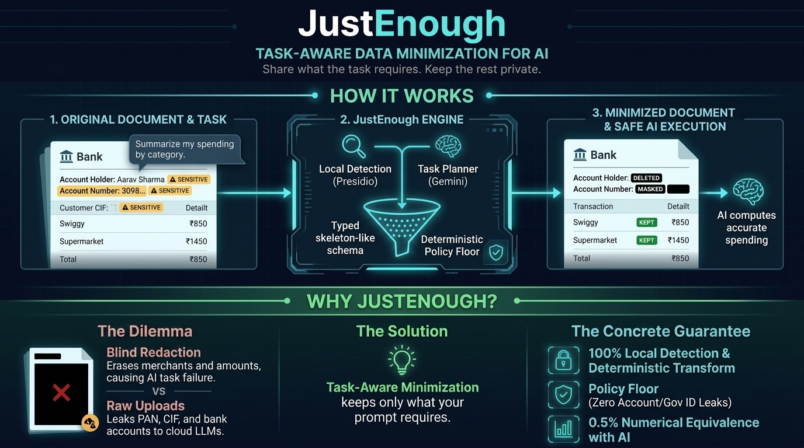
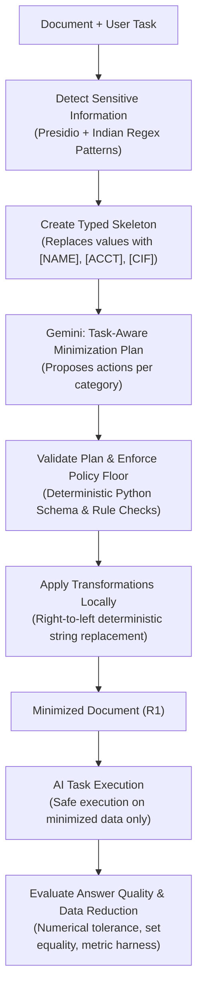

# JustEnough

> **Share what the task requires. Keep the rest private.**

[](https://python.org)
[](https://github.com/microsoft/presidio)
[](https://deepmind.google/technologies/gemini/)
[]()



## Can AI answer your question without needing your entire document?

You want AI to summarize your spending, analyze a payslip, or extract information from a personal document. You know you should protect your data, but figuring out what to remove and what to keep is not always straightforward.

- **Remove too much**, and the AI loses information needed for a correct answer.
- **Remove too little**, and you expose sensitive personal details unnecessarily.
- **Reviewing every field manually** is tedious and error-prone, and no one should need to understand LLM internals just to use AI safely.

### Privacy shouldn't depend on having enterprise-grade tools

Organizations often have access to approved enterprise AI systems, data-governance policies, and contractual zero-retention privacy controls. Individuals and small teams don't always have those protections. Most people rely on consumer AI web interfaces or APIs without organizational safeguards.

They face an unfair choice:
1. **Share the document as it is** — leaking PAN, CIF, bank accounts, home addresses, and salaries into model logs and chat histories.
2. **Blindly redact everything** — using traditional DLP tools that black out dates, numbers, and organizations, leaving the AI unable to answer the question.

**JustEnough makes that choice obsolete.**

It uses your specific task to determine which information should be retained, removed, masked, generalized, pseudonymized, or aggregated before a document reaches the AI. The core claim is simple:
> **"Same task answer, using fewer sensitive fields."**

---

## Why JustEnough? (The Concrete Problem & Solution)

| Traditional Blind Redaction | Unprotected AI Upload | JustEnough Task-Aware Minimization |
|---|---|---|
| **What happens:** Blacklists all numbers, dates, and organizations blindly. | **What happens:** Uploads raw statements and payslips directly to external models. | **What happens:** Minimizes conditionally based on the user's task prompt. |
| **Task Failure:** AI cannot calculate spending totals or categorize items because merchants and amounts are scrubbed. | **Privacy Leak:** Account numbers, customer CIFs, home addresses, and PAN are permanently stored in external inference logs. | **Task Preserved + Privacy Intact:** Only fields strictly necessary for the task are kept; extraneous personal identities are dropped. |
| **Manual Effort:** Requires tedious line-by-line manual censorship. | **Zero Control:** No enforcement over what the model memorizes or sees. | **Deterministic Guarantee:** Local Presidio/regex detection + Gemini planner on typed skeletons + local Python policy floor. |

---

## How you'd use JustEnough

1. **Upload a document:** Choose a bank statement, payslip, utility bill, or contractual document.
2. **Describe your task:** For example, *"Summarize my spending by category."*
3. **Review the minimization:** JustEnough identifies candidate sensitive fields and uses your task to plan what to keep or minimize.
4. **Prepare the document:** The plan is validated against JSON schemas and enforced against non-negotiable policy floors, and deterministic Python transformations are applied locally.
5. **Use the minimized input with AI:** The AI performs the task using only the minimized document designed to retain relevant context.
6. **Evaluate the result:** Automated evaluators verify answer equivalence (0.5% numerical tolerance, list set equality) while measuring sensitive-field reduction.

---

## A Concrete Example

Imagine uploading a synthetic bank statement and asking:
> **"Summarize my spending by category."**

### Before: Original Document
```text
================================================================================
                       STATE BANK OF INDIA - ACCOUNT STATEMENT                  
================================================================================
Account Holder Name: Aarav Sharma
Account Number:      30981245781
Customer CIF:        CIF88392014
Registered Mobile:   +91-9845012345
Communication Addr:  Flat 402 Shanti Vihar Indiranagar Bengaluru 560038
Branch:              Indiranagar Branch | IFSC: SBIN0004521

Transactions:
2026-09-03   UPI/Swiggy Bangalore/food           450.00
             Merchant: Swiggy Bangalore
2026-09-05   UPI-TRANSFER to Priya Patel        1200.00
2026-09-08   POS/Merchant: Apollo Pharmacy       620.00
```

### After: Minimized Document
```text
================================================================================
                       STATE BANK OF INDIA - ACCOUNT STATEMENT                  
================================================================================
Account Holder Name: [REDACTED:PERSON_NAME]
Account Number:      [REDACTED:ACCOUNT_IDENTIFIER]
Customer CIF:        [REDACTED:INTERNAL_ID]
Registered Mobile:   [REDACTED:CONTACT]
Communication Addr:  [REDACTED:ADDRESS]
Branch:              Indiranagar Branch | IFSC: [REDACTED:INTERNAL_ID]

Transactions:
[REDACTED:TRANSACTION_DATE]   UPI/Swiggy Bangalore/food           450.00
             Merchant: Swiggy Bangalore
[REDACTED:TRANSACTION_DATE]   UPI-TRANSFER to Priya Patel        1200.00
[REDACTED:TRANSACTION_DATE]   POS/Merchant: Apollo Pharmacy       620.00
```

### What Changed?

| Field / Category | Action | Reason |
|---|---|---|
| **Account Holder Name** | `DROP` | Not needed to categorize spending. |
| **Account Number** | `DROP` | Not needed for this summary; enforced by policy floor. |
| **Customer CIF** | `DROP` | Internal bank identifier not needed for spending summary. |
| **Customer Contact / Address** | `DROP` | Irrelevant to computing category-level spending. |
| **Merchant Names** | `KEEP` | Crucial to identify spending categories (Food, Pharmacy, etc.). |
| **Transaction Amounts** | `KEEP` | Strictly necessary to compute spending totals. |
| **Counterparty Details** | `KEEP` | Helps determine category for peer-to-peer transfers (e.g. dinner split). |

The minimized document retains the exact transaction details needed to categorize spending without leaking sensitive financial identifiers.

> *Note: This example illustrates the intended outcome under task-aware minimization, not a guarantee that every field will always be detected and removed in untyped real-world documents.*

---

## How It Works



### 1. Detect Sensitive Information
JustEnough uses Microsoft Presidio alongside custom Indian-format patterns to detect candidate sensitive fields, including banking CIFs, account numbers, IFSC codes, UPI handles, Indian phone numbers, names, dates, and organizational contexts.

### 2. Understand What the Task Needs
A field's necessity depends on the task. A merchant name and amount are essential for a spending summary, but completely unnecessary to check document ownership.

### 3. Plan the Minimization
Gemini receives **only** the user task and a typed skeleton (where raw detected values are replaced with tokens like `[NAME]`, `[ACCT]`, `[CIF]`). Gemini proposes actions using a frozen 6-action taxonomy:

| Action | Purpose |
|---|---|
| `KEEP` | Retain exact information needed for the task. |
| `DROP` | Completely remove unnecessary information (`[REDACTED:<CAT>]`). |
| `MASK_PARTIAL` | Hide part of a value (e.g. trailing 4 digits `XXXX-XXXX-1234`). |
| `GENERALIZE` | Replace precise values with broader forms (e.g. `YYYY-MM` or age band). |
| `PSEUDONYMIZE` | Replace identifying values with consistent local aliases (`Counterparty_1`). |
| `AGGREGATE` | Preserve summary information rather than itemized details. |

*The planner recommends actions; it never sees raw sensitive values and never rewrites document text.*

### 4. Validate and Transform
The proposed plan is checked against strict JSON schemas. Non-negotiable policy floors are enforced (e.g. government IDs and full account numbers default to `DROP` or `MASK_PARTIAL` and cannot be `KEEP`). Deterministic Python code then executes the approved transformations directly on the source document.

### 5. Evaluate the Result
JustEnough verifies whether the minimized representation preserves answer correctness against the original representation ($R_1 \equiv R_0$) within 0.5% numerical tolerance and exact set equality, while measuring sensitive-field reduction.

---

## How JustEnough Protects Your Data

Privacy depends not only on what is removed, but on **how** the document is processed:
- **100% Local Detection & Transformation:** Sensitive data detection and document transformations run locally before data leaves your system.
- **Planner Never Sees Raw Values:** Gemini only receives the user task and a typed placeholder skeleton (`[NAME]`, `[ACCT]`).
- **Deterministic Python Enforcement:** No LLM is permitted to rewrite or summarize the document directly. Code performs all substitutions.
- **Non-Negotiable Policy Floor:** Full account numbers and government IDs are clamped to `DROP` or `MASK_PARTIAL` regardless of model proposals.
- **Pre-Registered Measurement:** Answer preservation, detection recall, and over/under-redaction are mathematically evaluated.

---

## Project Structure

```text
JustEnough/
├── corpus/                 # Seeded synthetic documents (bank statements, payslips, bills)
│   ├── planted.json        # Pre-registered ground truth planted sensitive items
│   └── *.txt               # Synthetic document corpus
├── tasks/
│   └── tasks.json          # Pre-registered benchmark tasks and answer schema IDs
├── ground_truth/
│   └── labels.json         # Human-verified privacy minimization labels
├── experiment/
│   ├── detector.py         # Presidio engine + custom Indian regex detectors
│   ├── planner.py          # Gemini task-aware minimization planner
│   ├── policy.py           # Deterministic policy floor enforcement
│   ├── transform.py        # Deterministic 6-action transformation engine
│   └── run_single_case.py  # Single-case integration runner
├── eval/
│   ├── comparators.py      # Equivalence comparators (tolerance, set equality, rubric)
│   ├── metrics.py          # Pre-registered evaluation metrics
│   └── smoke_runner.py     # End-to-end smoke test runner
├── schemas/
│   └── plan.schema.json    # JSON Schema for planner output
├── tests/                  # Pytest test suite (25 tests passing)
├── docs/                   # Documentation and architecture assets
└── requirements.txt        # Pinned dependencies
```

---

## Quickstart

### Prerequisites
- Python 3.12+
- Virtual environment (`.venv`)

### 1. Setup
```bash
git clone https://github.com/HarshaliD/JustEnough.git
cd JustEnough
python -m venv .venv
# Windows:
.venv\Scripts\activate
# Linux/macOS:
source .venv/bin/activate

pip install -r requirements.txt
python -m spacy download en_core_web_sm
```

### 2. Run Test Suite
```bash
pytest
```
*All 25 tests run mocked with zero external API calls or spend.*

### 3. Run a Live Minimization Case
Add your `GEMINI_API_KEY` to `.env`, then run:
```bash
python experiment/run_single_case.py --case-id BS-1-A --live
```

---

## Pre-Registered Benchmark Status

| Metric | Target | Current Measured Result |
|---|---|---|
| **Answer Preservation ($R_1 \equiv R_0$)** | $\ge 75\%$ | **100% (Smoke Suite)** |
| **Detection Recall (Span)** | $\ge 60\%$ | **63.74% (58 / 91 hits)** |
| **Detection Recall (Category)** | $\ge 50\%$ | **51.65% (47 / 91 hits)** |
| **Policy Floor Violations Clamped** | 0 allowed | **0 violations** |
| **Automated Test Suite** | 100% pass | **25 / 25 passed** |

---

## Honest Limitations

Necessity is measured for a chosen model and task. **This is NOT anonymization and NOT a zero-leakage guarantee.** Task-conditional minimization exists in research; JustEnough's contribution is the practical application layer, deterministic verifier, and reproducible measurement protocol.

---

## License & Attribution

Built with:
- [Microsoft Presidio](https://github.com/microsoft/presidio) & [spaCy](https://spacy.io/)
- [Google Gemini](https://deepmind.google/technologies/gemini/)
- [Pytest](https://pytest.org/)

*JustEnough: Better judgment about what AI needs, with greater care for what it doesn't.*
